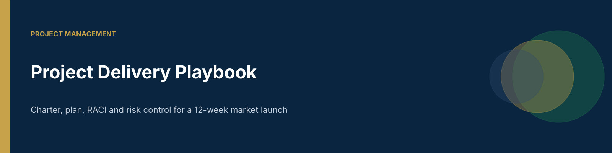
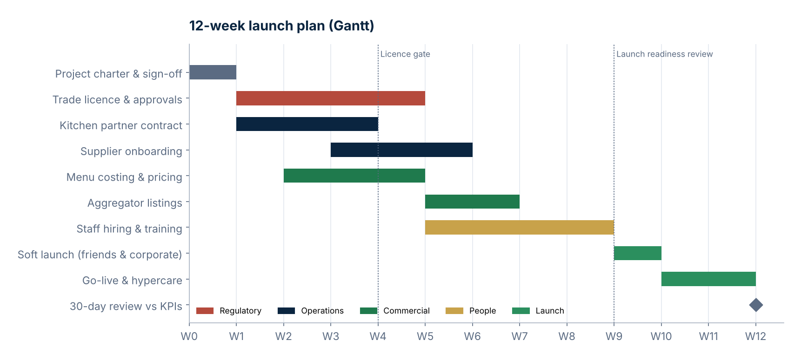
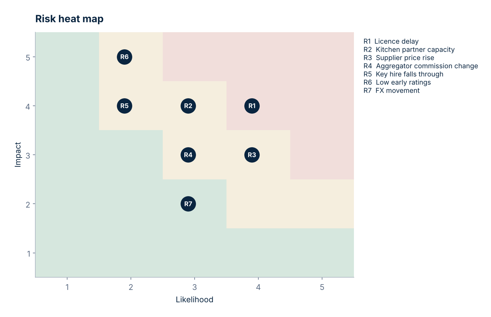

# Project Delivery Playbook: 12-Week Market Launch

**How to take a strategy decision and land it on time.** This playbook turns the recommendation from [Market Entry Strategy: UAE](https://github.com/sohaibshabbir9-del/market-entry-strategy-uae) (launch through a shared cloud-kitchen partner) into a controlled 12-week project: charter, plan, roles, risks and reporting.

> **Data note.** The project, dates, roles and risks are **hypothetical**, built to demonstrate project coordination and operational planning.

---

## 1. Project charter

| Item | Detail |
|---|---|
| **Objective** | Launch a premium food delivery brand from a partner kitchen in Dubai within 12 weeks of approval |
| **Scope (in)** | Trade licence, kitchen partner contract, suppliers, menu costing, aggregator listings, hiring and training, soft launch, go-live |
| **Scope (out)** | Own kitchen fit-out, direct-ordering app, second location (Phase 3) |
| **Success measures** | Go-live by week 12 · launch budget within ±10% · rating ≥ 4.5★ after 30 days · positive contribution margin by month 3 |
| **Key assumptions** | Licensed partner kitchen available; menu deliverable with local suppliers |
| **Governance** | Weekly status report (Friday) · sponsor review at licence gate (week 4) and launch readiness (week 9) |

## 2. Plan

**Critical path:** licence → supplier onboarding → aggregator listings → soft launch. A slip in licensing moves go-live day for day, which is why it is the first risk on the register.

## 3. Roles: RACI

| Workstream | Sponsor | Project lead | Ops lead | Commercial lead | Finance | HR |
|---|:-:|:-:|:-:|:-:|:-:|:-:|
| Charter & sign-off | **A** | R | C | C | C | I |
| Licence & approvals | I | **A** | R | I | C | I |
| Kitchen partner contract | **A** | R | R | C | C | I |
| Supplier onboarding | I | **A** | R | C | C | I |
| Menu costing & pricing | C | **A** | C | R | C | I |
| Aggregator listings | I | **A** | C | R | I | I |
| Hiring & training | I | **A** | R | I | C | R |
| Go-live & hypercare | I | **A** | R | R | I | I |

*R = Responsible · A = Accountable · C = Consulted · I = Informed. One A per row, checked automatically in the workbook.*

## 4. Risk management

| ID | Risk | Score | Mitigation | Owner |
|---|---|:-:|---|---|
| R1 | Licence delay | 16 🔴 | Licensing consultant from week 1; weekly check | Project lead |
| R2 | Kitchen partner capacity | 12 🟠 | Contract minimum slot hours; backup partner identified | Ops lead |
| R3 | Supplier price rise | 12 🟠 | 90-day fixed prices with two suppliers; re-cost trigger at +5% | Commercial lead |
| R6 | Low early ratings | 10 🟠 | Soft launch with corporate pilots; daily feedback review | Ops lead |

Full register (7 risks, scoring, RAG and status) in the workbook.

## 5. Reporting rhythm

| Cadence | Output | Audience |
|---|---|---|
| Daily (launch weeks) | 10-minute stand-up: blockers only | Delivery team |
| Weekly (Friday) | One-screen status report: RAG, progress, next week, risks, decisions needed | Sponsor and leads |
| Stage gates | Go / no-go pack against charter success measures | Sponsor |
| Day 30 | Post-launch review vs KPIs and lessons learned | All |

## 6. Deliverables

| File | Contents |
|---|---|
| [`templates/project-control-workbook.xlsx`](templates/project-control-workbook.xlsx) | **Risk register** (auto score and RAG, status drop-down) · **RACI** (colour-coded, one-A check) · **Weekly status** report template |

## 7. How to use

1. Rewrite the charter for your project and get it signed off before work starts.
2. Replace the sample risks and re-score them weekly; anything red goes in the status report.
3. Fill the RACI with real names; fix any row the check column flags.
4. Send the weekly status every Friday, even when it is all green.

---

Prepared by <a href="https://github.com/sohaibshabbir9-del">Sohaib Shabbir</a> · Project coordination & operational planning · Hypothetical project for portfolio purposes.
